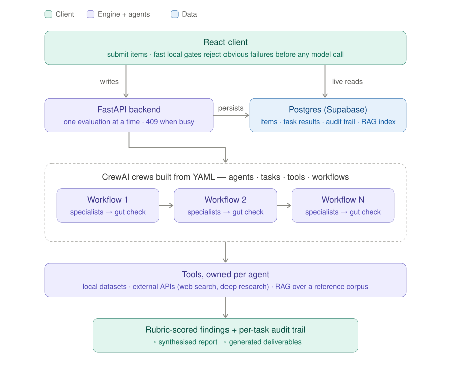

# OpenScrutiny

**A multi-agent engine for evaluating anything against a strict rulebook, then generating the paperwork.**

[](LICENSE)
[](https://github.com/that-mike-bal/open-scrutiny/actions/workflows/test.yml)

Define expert agents, a ruleset, tools, and a workflow in YAML. Get auditable, rubric-scored assessments with cited sources for every item you feed in, then draft the deliverables those assessments feed into. It ships with one brutal worked example: evaluating proposed top-level domain strings against the ICANN New gTLD Program rulebook.

> **Screenshot placeholder.** A capture of the evaluation report and audit-log view belongs here. The UI needs a Supabase project to render, so no screenshot is bundled yet; see the [roadmap](#status-and-roadmap).

**Stack:** CrewAI · Google Gemini (GPT-4o fallback) · FastAPI · React + Vite + TypeScript · Supabase (Postgres + pgvector)

---

## The 60-second model



1. **Items come in** through the React client or the HTTP API. Cheap local gates reject obvious failures before any model is called.
2. **Workflows run in sequence.** Each workflow is a CrewAI crew assembled at runtime from four YAML files: `agents.yaml`, `tasks.yaml`, `tools.yaml`, `workflows.yaml`.
3. **Specialist agents own their tools.** Every agent declares which tools it may call and what context it produces and consumes, so behaviour is predictable and auditable.
4. **Every task produces a rubric-shaped report.** Task prompts end in an `expected_output` template with explicit statuses (PASS / FLAGGED / BLOCKED, Minimal → High per dimension), and a closing gut-check task looks for contradictions.
5. **Findings are stored with an audit trail**, then synthesised into a report and routed into the generation half, which drafts deliverables from the findings plus a knowledge base.

The engine is config-driven: retargeting it means editing YAML and data, not Python. [docs/ARCHITECTURE.md](docs/ARCHITECTURE.md) has the full picture, and [docs/KNOWLEDGE_BASE.md](docs/KNOWLEDGE_BASE.md) covers the rulebook index agents look things up in.

---

## The bundled example: gTLD string evaluation

ICANN's New gTLD Program lets organisations apply to run their own top-level domain. An application costs six figures in non-refundable fees, and the string itself is judged across technical, legal, and policy dimensions against a rulebook that runs to hundreds of pages: DNS stability rules, similarity to the 1,500+ delegated TLDs, name-collision data, trademark conflicts across jurisdictions, geographic-name rules, government objections grounded in precedent, and cultural meaning in other languages. A human analyst takes days per string. Applicants want to know, before committing capital, whether a string will survive and what to mitigate.

That makes it the hardest version of the "rulebook + candidates" pattern: hard binary gates alongside interpretive judgement, external databases and precedent, and an expensive, irreversible outcome. If the engine can do this, it can do a vendor policy, a grant rubric, or a brand guideline. The example runs three workflows per string:

| Workflow | Agents | Tools | What it checks |
|---|---|---|---|
| `technical_risk_assessment` | String analyst, collision analyst, validator | `string_analyzer`, `similarity_analyzer`, `magnitude_collision_checker`, `guidebook_search` | DNS label and RFC syntax rules; visual and phonetic similarity against the IANA root database; name-collision magnitude from ICANN research data; validator gut check |
| `legal_risk_assessment` | Legal & IP risk analyst, validator | `deep_research_legal_analyzer` (Gemini Deep Research over USPTO, EUIPO, WIPO, patents, web), `guidebook_search` | Trademark and patent conflicts weighed by holder viability, class overlap, and fame rather than raw text matches; validator re-checks the research and runs the gut check |
| `policy_safeguard_review` | GAC safeguard risk analyst, validator | `brave_web_search`, `gac_precedent_analyzer`, `similarity_analyzer`, `guidebook_search` | Geographic-name status, ICANN safeguard questions, cultural and linguistic meaning across languages, government-objection risk against 242 GAC Early Warning precedents; validator gut check |

The deep walkthrough, from the public Applicant Guidebook to each agent, task rubric, tool, and how the crew is assembled, is in [docs/examples/icann-gtld.md](docs/examples/icann-gtld.md).

---

## Quick start

### Prerequisites
- Python 3.12 (CrewAI dependency)
- Node.js 18+
- A Supabase project (free tier is fine)
- A Google Gemini API key (and optionally OpenAI/others — see `env.example`)

### 1. Configure environment
```bash
cp env.example .env                 # backend: fill in Gemini + Supabase keys
cp client/env.example client/.env   # frontend: Supabase URL + anon key only
```
Credentials are read only from the environment — nothing is hardcoded, and the
Supabase **service-role key is backend-only** (never a `VITE_` variable).

### 2. Set up the database (bring your own — Supabase recommended)
The app needs a PostgreSQL database; we recommend [Supabase](https://supabase.com)
(free tier). Deploy the empty schema to a fresh project, then seed the example.
The repo ships **no data** — you bring your own database.
```bash
# In the Supabase SQL editor (or psql), run, in order:
#   db/schema.sql                        -> creates all tables (empty, per-user RLS)
#   then db/migrations/*.sql in order    -> incremental updates (see db/README.md)
python scripts/categorize_questions.py   # seed the example ruleset/questions
python scripts/setup_rag_database.py     # build the RAG index from the sample knowledge base
```
See [db/README.md](db/README.md) for the full deploy order and recommendations.

### 3. Run it
```bash
# Backend
cd crewai_service && python3 app.py

# Frontend (separate terminal)
cd client && npm install && npm run dev
```

### 4. Run the tests
```bash
pytest -q                       # backend + integration (everything mocked; placeholder keys are fine)
cd client && npm run build-strict && npx vitest run
```
`tests/live/` needs a running backend and real keys; it is excluded from the default run.

> The bundled example's agents look rules up in a pgvector index of the public *ICANN Applicant Guidebook*. The PDF is not included (it's large and ICANN's); the evaluation runs without it and the guidebook tool says so. [docs/KNOWLEDGE_BASE.md](docs/KNOWLEDGE_BASE.md) explains how to load it and how to swap in your own corpus.

The engine is usable headless: `POST /api/evaluations/auto-submit` starts an evaluation and `GET /evaluations/{id}/workflows` reports progress. See [docs/API_REFERENCE.md](docs/API_REFERENCE.md).

---

## Adapt it to your rulebook

The ICANN example lives entirely in configuration and data. [docs/ADAPTING.md](docs/ADAPTING.md) is a step-by-step tutorial that builds a second, tiny ruleset (a product name checked against a brand guideline: two agents, three tasks, one local-data tool) under [`examples/brand-name-check/`](examples/brand-name-check/) and runs it. To retarget the engine yourself, grep for the markers:

```bash
grep -rn "CUSTOMIZE:" crewai_service scripts client/src
```

Each marker explains what to change. The main surfaces:

| What | Where |
|------|-------|
| Evaluation agents (the expert roles) | `crewai_service/evaluation/config/agents.yaml` |
| The ruleset (prompts, inputs, outputs per step) | `crewai_service/evaluation/config/tasks.yaml` |
| Tools agents can call | `crewai_service/evaluation/config/tools.yaml` |
| Which agents/tasks run, in what order | `crewai_service/evaluation/config/workflows.yaml` |
| Runtime knobs (memory, rate limits per environment) | `crewai_service/environment.yaml` |
| Generation agents + tasks | `crewai_service/application/config/*.yaml` |
| Generation handlers + field routing | `crewai_service/answer_generation_service.py` |
| Item/question schema + categories | `scripts/categorize_questions.py` |
| UI output types and sections | `client/src/components/CreateApplicationModal.tsx`, `client/src/lib/section-utils.ts` |

Crew assembly (`crewai_service/crew.py`) reads the YAML above — you usually retarget by editing the config and data, not the Python. `CrewBuilder()` defaults to `evaluation/config/`; pass `CrewBuilder(config_dir=...)` to point it at another tree. The generation half is built from `application/config/`.

---

## Design decisions

- **Qualitative rubric over numeric scores.** Early versions emitted a single risk number per string. It looked precise and was not. Reports now use five qualitative levels per dimension (Minimal, Low, Moderate, Concerning, High) and lead with flags, each carrying the specific conflicting string, mark, jurisdiction, or magnitude that caused it.
- **Memory off between items.** CrewAI memory is disabled for every agent and crew (`memory: false`), and per-environment settings in `environment.yaml` enforce it. One string's trademark findings must never leak into the next string's report.
- **Single-threaded queue with 409.** One evaluation runs at a time. A second submission gets HTTP 409 and the client-side queue retries. That was chosen over a Celery and Redis job system for a workload where throughput was never the bottleneck, and it keeps the audit trail unambiguous.
- **Regex extraction over structured output.** Task results are classified by pattern matching on the report text (`_classify_result_status` in `crewai_service/app.py`) with explicit failure phrases checked first and `REVIEW_REQUIRED` as the ambiguous default. It survives model output drift better than a strict schema and never silently marks a degraded run as clear.
- **Validator and gut-check layers.** A separate validation-mode agent (`validation_mode: true`, `contradiction_detection: true`), with no stake in the findings, runs the legal validation pass and closes every workflow with a short gut check over the preceding outputs for logic, consistency, and completeness. Each stored task carries a 0–1 confidence score derived from tool data reliability and result certainty.

---

## Status and roadmap

**v0.1.0.** The engine, the bundled example, the React client, and the generation half are complete and documented; 115 backend tests and a strict TypeScript build pass in CI.

Planned next:
- A bundled sample report and UI screenshots.
- Rewrite the frontend unit tests against the current components and gate ESLint in CI.
- Split the 3,700-line `crewai_service/app.py` into routers.
- Structured-output experiment alongside the regex classifier, with the audit trail deciding which wins.

See [CHANGELOG.md](CHANGELOG.md) for history and [CONTRIBUTING.md](CONTRIBUTING.md) if you want to help.

## Documentation

[docs/README.md](docs/README.md) indexes everything: architecture, the ICANN walkthrough, the adapting tutorial, the HTTP API, deployment, the database schema, and data sources.

## License

MIT — see [LICENSE](LICENSE).

This is a portfolio/sample project. The bundled gTLD example uses the public
ICANN program as a demonstration domain; all applicant data in the repo is
fictional.
